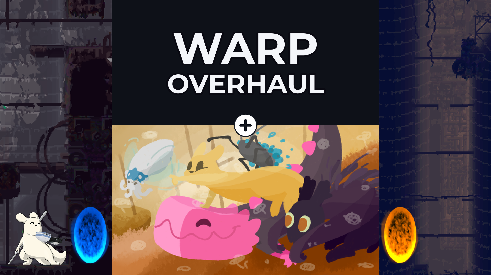

# Warp For Meadow

A fork of [Warp Menu](https://github.com/LeeMoriya/Warp) by LeeMoriya, with the code reworked and a fix for Rain Meadow.
Mozilla Public License 2.0, see [LICENSE](LICENSE).

Warp adds a menu to Rain World's pause screen for teleporting to any room, in any region, without using gates. It is
mostly for testing mods and building custom regions. The current region's rooms are on the right and the regions on the
left. Click a room to warp there, or a region to list its rooms.

## Rain Meadow

A warp to another region used to freeze the game for good in a Meadow lobby. Regions now load a step each frame, so the
game keeps running. 

Pausing in a lobby does not stop the game, and the world is not drawn while paused. That is Rain Meadow's own behaviour.

## Install

No prebuilt releases yet. Build it below, or use the Steam Workshop once it is published. Needs Rain World with BepInEx.

## Build

Needs the .NET 8 SDK and Rain World with BepInEx, run once so it creates the libraries the build uses.

    dotnet build Warp.csproj -c Release -t:PackageMod

The mod is staged in `bin/package/warp-for-meadow`. Put a `thumbnail.png` in `package/` first to include it. If the game
is not in a usual Steam folder, add `-p:RainWorldDir="/path/to/Rain World"` or set `RAINWORLD_DIR`.

A Debug build (no `-c Release`) copies `Warp.dll` into the game's `mods/warp` folder if there is one, overwriting it.
Add `-p:DeployToGame=false` to build into `bin/Debug` instead.

The plugin targets .NET Framework 4.8, which is what Rain World runs on, with newer C# syntax. See
`src/Util/IsExternalInit.cs` for how.

## Tests and docs

    dotnet run --project tests/Warp.Tests.csproj

[docs/testing.md](docs/testing.md) has the in-game checks and how to watch the log.
[docs/architecture-review.md](docs/architecture-review.md) shows how the code fits together.
