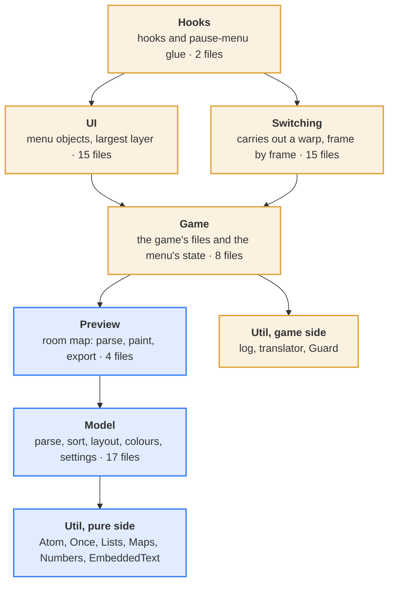
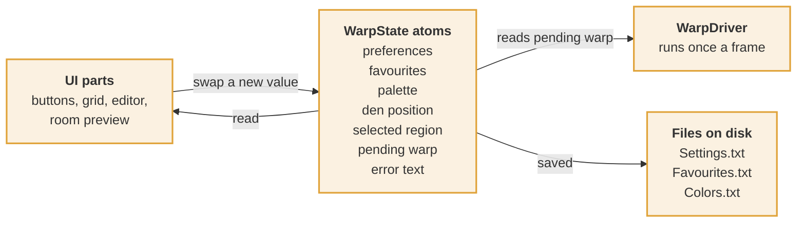
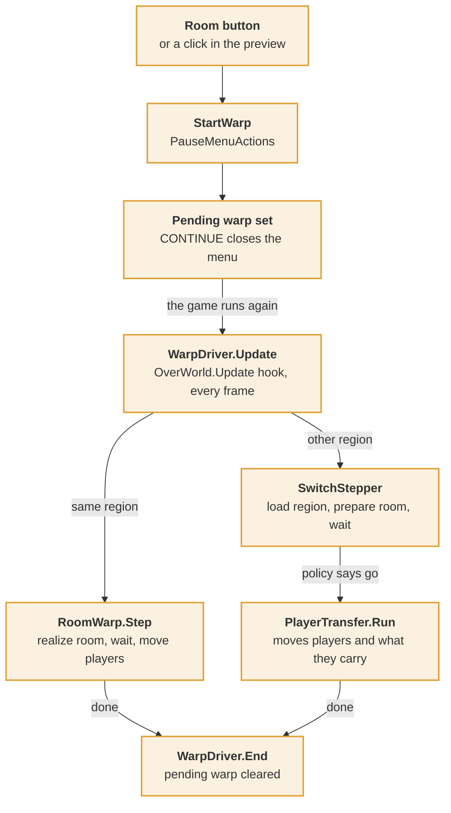
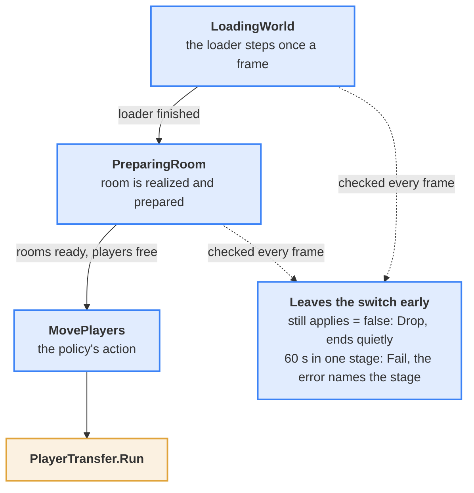
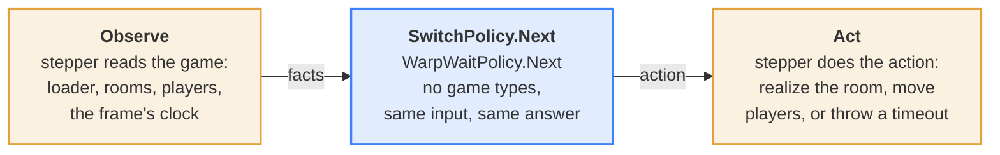
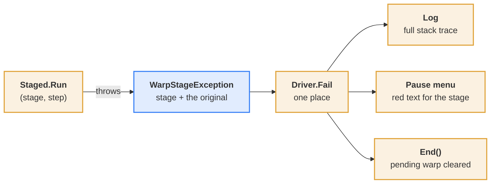
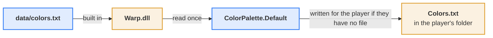
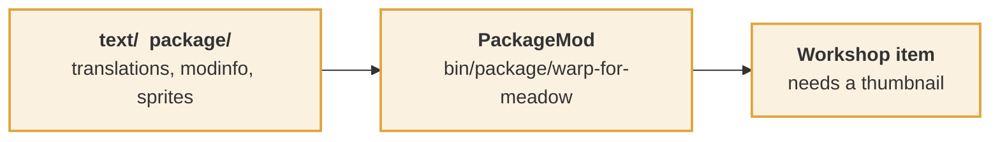

# Warp architecture

Warp adds a menu to the pause screen. Clicking a room moves the players there, loading the room's region first if
needed. This page shows how the code is arranged and why.

In the diagrams, **blue-bordered** boxes are decided in pure code and tested without the game, and **amber-bordered**
boxes touch the game and are checked in the game.

| 7 | 73 | ~6.7k | 400 | 9 |
| --- | --- | --- | --- | --- |
| layers | source files | lines | automatic checks | manual checks in game |

## Layers

Each layer uses only the layers below it. Model and Preview never mention a game type, so the test project compiles them
as they are.

Every layer also uses Model and Util directly. UI and Switching never use each other. The Switching and Util files that
need no game are compiled into the tests too; the amber ones are not.

## State

Seven atoms in `WarpState` hold everything the menu remembers. Each holds an immutable record, so a reader sees one whole
value or the next one, never half of a change.

Preferences and favourites are saved by their setters. Colours change in memory as the sliders move and reach the disk
on SAVE. `RegionCatalog` is a second atom: the regions read so far.

## One warp, end to end

A click only records a request and closes the pause menu. The warp itself runs inside the game's own update, one frame at
a time.

Any exception on this path goes to the failure route shown below.

## Region switch

A region loads over many frames, so the game keeps running while it does. That is the Rain Meadow freeze fix. Each
frame, a pure policy decides the next move from what the game looks like.

The loader is left idle if the pause menu cancels the switch part way. The game has no way to stop it.

## Decisions and effects

The stepper only gathers facts and carries out actions. Every choice in between is a pure function, so each timeout and
each drop is unit-tested.

The new state is kept, so the next frame starts from it. The warp inside a region uses the same shape with
`WarpWaitPolicy`: wait, go, drop or time out.

## When something fails

A step runs as a named stage. A failure leaves carrying that stage, the innermost one wins, and the player sees the
message for it.

A fault inside Warp's own part of a hook is logged once for each place by `Guard` and never reaches the game.

## Where Warp runs inside the game

Four hooks. In each, the game's method runs untouched, and Warp's part sits before or after it inside its own `try`.

| Hook | Warp, before | The game's method | Warp, after |
| --- | --- | --- | --- |
| `PauseMenu` constructor | `Prepare` | builds the pause menu | `Attach`: add the Warp panel |
| `PauseMenu.Singal` | `Signal`: room and toggle buttons | handles the message | none |
| `PauseMenu.Update` | none | updates (skipped while a preview is open) | `Update`: keys, F5 scan |
| `OverWorld.Update` | none | the world update | `WarpDriver.Update` |

A hook never leaves out the game's method, apart from the paused update while a preview is open.

## Data and packaging

The built-in colours are data, not code. They live in one file that is built into the plugin and copied out for the
player to edit.

The game reads `text/` and `package/` from fixed places, so they stay where they are. `data/` holds one file so far. The
room-tag table is the next candidate.

## How it is checked

| Layer | Checked by |
| --- | --- |
| Model, Preview | Compiled into a net8 test project, so a game type there fails the build. 400 automatic checks. |
| Switching, Util (pure files) | The policies, `Staged`, `Atom`, `Once` and the helpers are compiled into the same tests. |
| Game, UI, Hooks | In the game, with the short checklist in [testing.md](testing.md) and the log. |
| SwitchStepper, PlayerTransfer, RoomWarp | In the game only. Their decisions are in the pure policies; the effects are not. |
